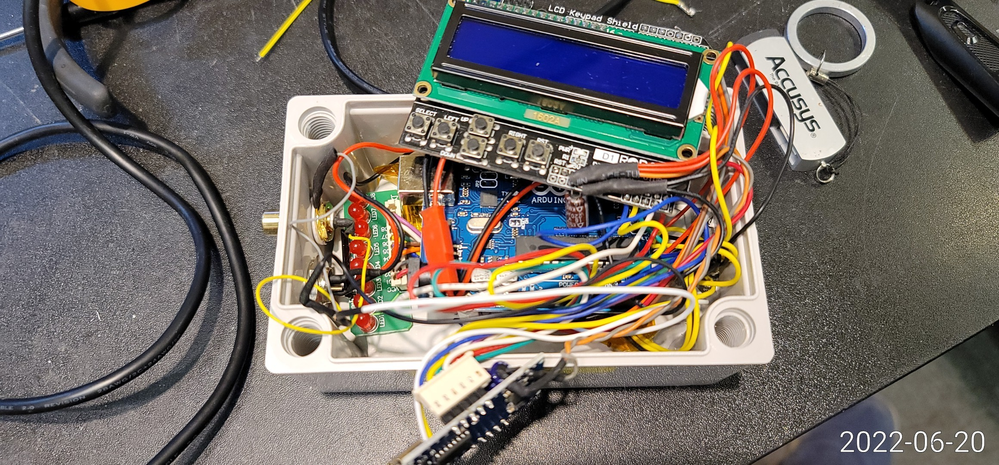
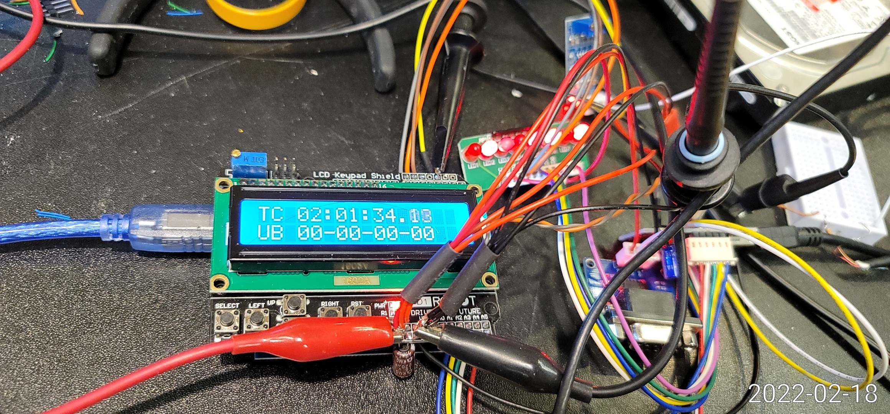
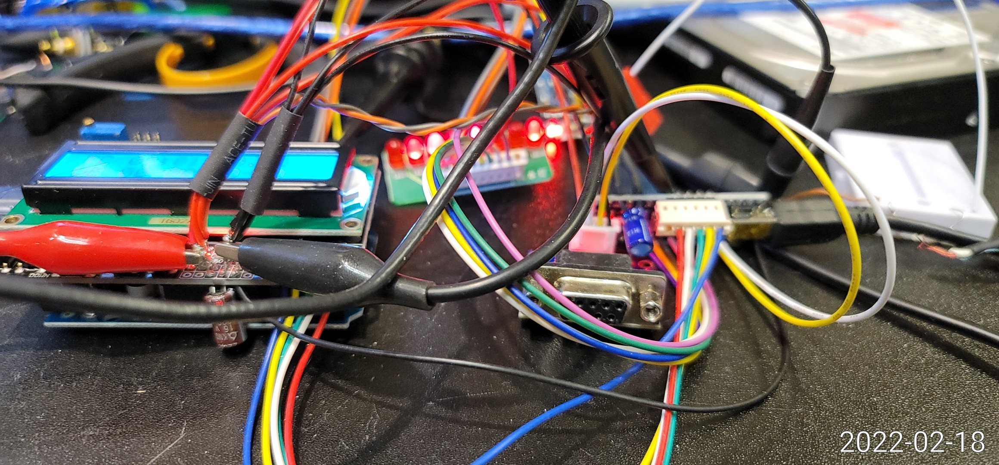
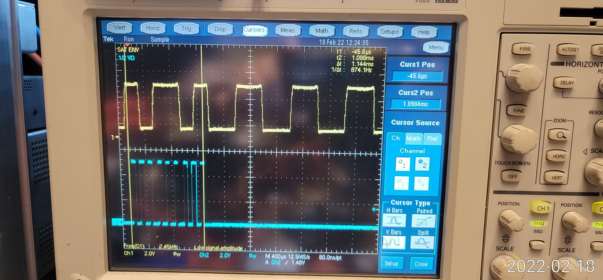

# SMPTE-LTC-DECODER
SMPTE LTC DECODER / PC INTERFACE (ARDUINO)

Decode analog LTC singal<br>
Shows TC, UB Data in 16x2 LCD<br>
RS232 Interface with PC

Two arduinos are used.
  - Arduino UNO for LTC pulse detection
  - Arduino NANO for PC serial interface

---

# SMPTE LTC 디코더

아날로그 **SMPTE LTC(Linear Timecode)** 오디오 신호를 해독해 16x2 LCD에 타임코드(TC)와 유저비트(UB)를 표시하고, RS-232로 PC에 타임코드를 전송하는 Arduino 장치입니다.

> Designed & coded by sendust (SBS)

| 완성품 | 동작 화면 |
|---|---|
|  |  |

동작 영상: [`VID_20220620_173549.mp4`](VID_20220620_173549.mp4)

---

## 주요 기능

- **LTC 해독** — 바이페이즈(Biphase Mark) 신호의 펄스 폭을 인터럽트로 측정해 비트를 복원
- **LCD 표시** — `TC HH:MM:SS.FF` + 컬러프레임(`c`)·드롭프레임(`d`) 플래그, `UB xx-xx-xx-xx`
- **PC 인터페이스** — `HH:MM:SS.FF` 문자열을 RS-232(DB9)로 프레임마다 전송
- **NTSC / PAL** — 컴파일 옵션으로 29.97/30fps 또는 25fps 타이밍 선택
- **LED 상태 표시** — 하트비트, 싱크 검출, 전송 완료, 오류 표시

## 왜 Arduino가 두 개인가

LTC 비트 하나는 NTSC에서 약 417µs, 반 비트는 약 208µs입니다. 펄스 폭을 정확히 재려면 인터럽트 처리가 방해받으면 안 되는데, 시리얼 출력은 이보다 훨씬 오래 걸립니다.
그래서 **디코더**는 펄스 측정과 LCD 표시만 하고, 해독한 타임코드를 4비트 병렬 신호로 넘기면 **인터페이스**가 받아서 PC로 시리얼 전송합니다.

```
LTC 입력 ──> [LM358 증폭·정형] ──> [디코더 Arduino] ──4bit + CLOCK──> [인터페이스 Arduino] ──> [DS275] ──> RS-232 (DB9) ──> PC
                                       │
                                       └─> 16x2 LCD
```

## 하드웨어

회로도: [`LTC_DECODER_SCHEMATIC.pdf`](LTC_DECODER_SCHEMATIC.pdf) (Eagle)

| 부품 | 역할 |
|---|---|
| LM358 모듈 | LTC 오디오 신호 증폭 및 구형파 정형 ([`LM358_MODULE.jpg`](LM358_MODULE.jpg)) |
| Arduino UNO + LCD Keypad Shield | 디코더 — LTC 펄스 측정, LCD 표시 |
| Arduino NANO | 인터페이스 — 4비트 데이터 수신, 시리얼 전송 |
| DS275 | RS-232 레벨 변환 |
| DB9 커넥터 | PC 연결 |
| LED x8 | 상태 표시 |

회로도에는 두 보드 모두 Arduino NANO로 그려져 있으며, 핀 연결은 UNO와 같습니다.

### 연결

| 신호 | 디코더 | 인터페이스 |
|---|---|---|
| LTC 입력 (LM358 출력) | D2 (INT0) | — |
| 데이터 bit3 (MSB) | A1 | A1 |
| 데이터 bit2 | A2 | A2 |
| 데이터 bit1 | A3 | A3 |
| 데이터 bit0 (LSB) | A4 | A4 |
| 클럭 | A5 | A5 |
| LCD (RS, E, D4~D7) / 백라이트 | D8, D9, D4~D7 / D10 | — |
| 시리얼 TX → DS275 | — | D9 (SoftwareSerial) |
| GND | 공통 | 공통 |

### LED

| 위치 | 핀 | 의미 |
|---|---|---|
| 디코더 | D13 | 하트비트 (TC 대기 중 깜빡임) |
| 디코더 | D12 | 타임코드 1프레임 해독마다 토글 |
| 디코더 | D11 | 싱크 워드 검출마다 토글 |
| 인터페이스 | D6 | 타임코드 전송 완료마다 토글 |
| 인터페이스 | D2~D5 | 동작 표시(순차 점등) / 데이터 길이 오류(D2), 버퍼 오버플로(D3) |

## 펌웨어

| 파일 | 보드 | 설명 |
|---|---|---|
| `SMPTE_Timecode_Reader.ino` | 디코더 (UNO) | LTC 해독, LCD 표시, 4비트 병렬 출력 |
| `SMPTE_TIMECODE_READER_BCD_INTERFACE.ino` | 인터페이스 (NANO) | 4비트 병렬 수신, 시리얼 전송 |

Arduino IDE 기본 라이브러리(`LiquidCrystal`, `SoftwareSerial`)만 사용합니다.

### NTSC / PAL 선택

기본값은 NTSC(29.97/30fps)입니다. PAL(25fps) 신호를 받으려면 `SMPTE_Timecode_Reader.ino`에서 아래 줄의 주석을 풀고 다시 업로드합니다.

```cpp
// #define PAL         // Comment out or delete this line for NTSC signal timings
```

| 규격 | 1비트 길이 | 에지 간격 판정 (µs) |
|---|---|---|
| NTSC | 약 417µs | 104 미만 또는 521 초과 = 오류, 312 초과 = `0`의 에지, 그 외 = `1`의 반쪽 에지 |
| PAL | 500µs | 125 미만 또는 625 초과 = 오류, 375 초과 = `0`의 에지, 그 외 = `1`의 반쪽 에지 |

## 동작 원리

### 1. LTC 해독 (디코더)

1. D2 핀의 상승·하강 에지마다 인터럽트가 발생해 직전 에지와의 시간 간격을 잽니다.
2. 간격이 길면 `0`, 짧은 간격이 두 번 이어지면 `1`로 판정해 버퍼에 넣습니다.
3. 마지막 16비트가 싱크 워드 `0xBFFC`와 같으면 앞의 64비트를 타임코드로 확정합니다.
4. 메인 루프에서 시·분·초·프레임, 드롭/컬러 프레임 플래그, 유저비트를 꺼내 LCD에 표시합니다.

### 2. 4비트 병렬 전송 (디코더 → 인터페이스)

타임코드 8자리를 한 자리씩 4비트(BCD)로 A1~A4에 올리고 A5 클럭을 50µs 동안 HIGH로 만듭니다. 마지막에 종료 코드 `10`(`1010`)을 보냅니다.

```
H H M M S S F F END      →  9번의 클럭
0 2 0 1 3 4 0 8 10
```

### 3. 시리얼 출력 (인터페이스 → PC)

인터페이스는 A5의 상승 에지마다 A1~A4를 읽어 버퍼에 쌓고, 종료 코드를 받으면 문자열을 만들어 보냅니다.

| 포트 | 속도 | 내용 |
|---|---|---|
| RS-232 (DB9, SoftwareSerial D9) | 115200bps, 8N1 | `HH:MM:SS.FF` + CR |
| USB (Serial) | 115200bps | 디버그용: 수신 자리 수 + 타임코드, 오류 메시지 |

받은 자리 수가 9가 아니면 `Invalid data length`, 버퍼가 넘치면 `Buffer overflow`를 USB 시리얼로 출력합니다.

## 사진

| | |
|---|---|
|  |  |

## 변경 이력

- 2022/02/10 — LTC 디코더 수정 시작 (ISR 기반, LED 피드백)
- 2022/02/14 — 4비트 병렬 출력 (A1~A4 데이터, A5 클럭), Arduino 2개 구성
- 2022/02/15 — 드롭프레임·컬러프레임 플래그 LCD 표시, 인터페이스 첫 릴리스
- 2022/02/16 — LED 피드백 클래스, 하트비트 클래스
- 2022/02/18 — 하트비트 개선, 클럭 LOW 구간 지연 추가, LED 표시 성능 개선
- 2022/03/25 — 유저비트 순서 정리
